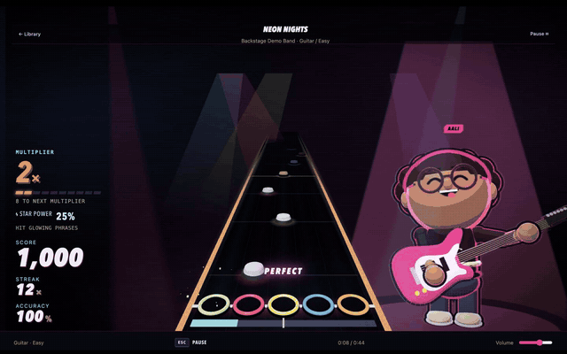
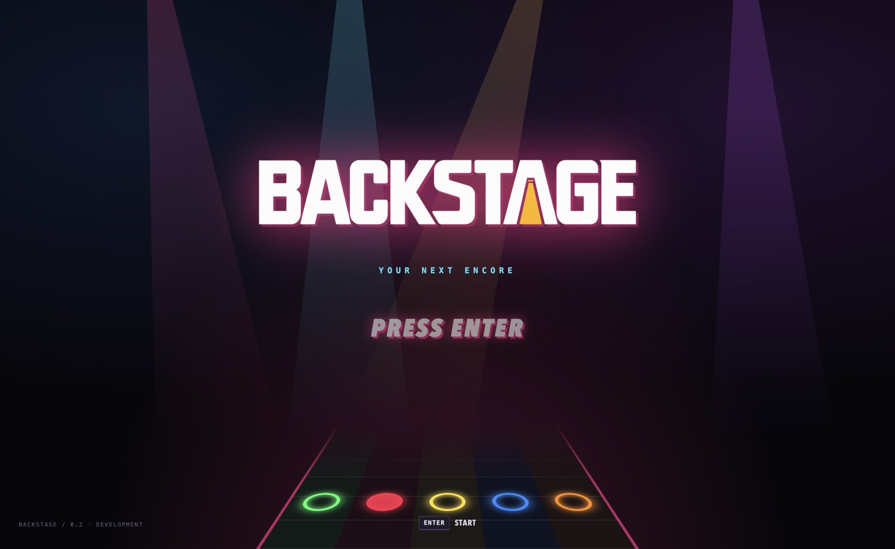
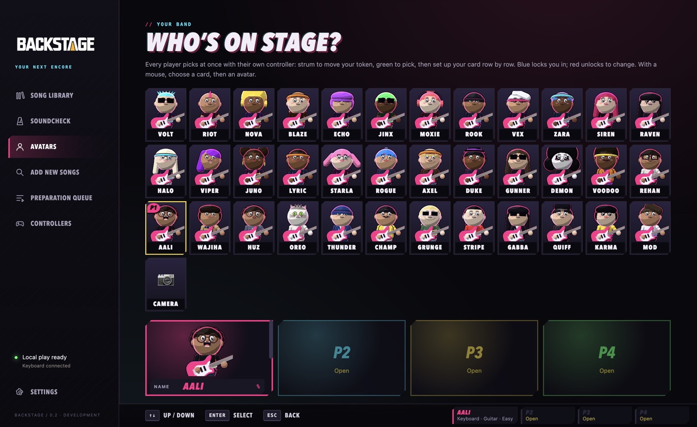
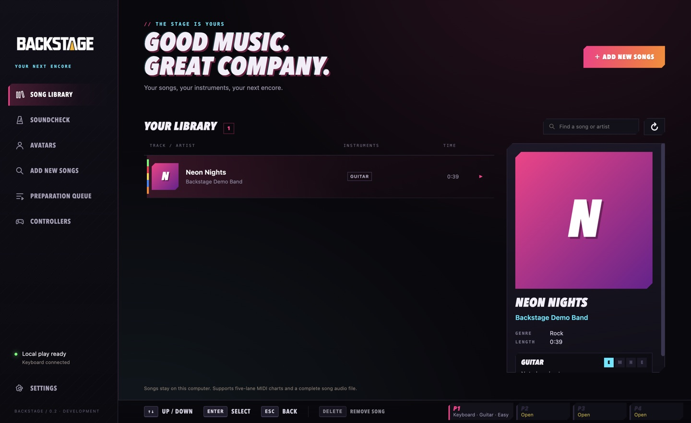
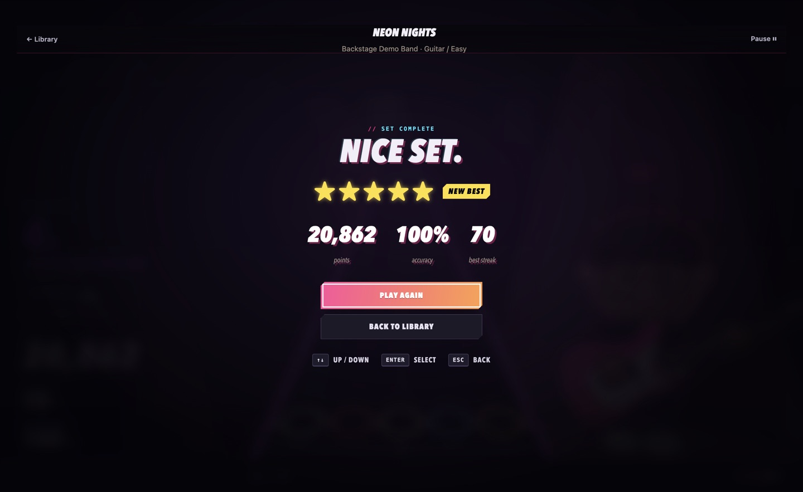

# Backstage

Backstage is a rhythm gaming and venue operations product: a customer game,
local hardware/employee tools, and a future multi-venue management platform.

## Play Backstage

[](https://github.com/Hanzala-plyance/backstage/releases/latest/download/backstage-demo.mp4)

**⬇️ [Download Backstage for Mac (Apple silicon)](https://github.com/Hanzala-plyance/backstage/releases/latest/download/Backstage-0.2.0-macOS-AppleSilicon.zip)**
· [Demo song](https://github.com/Hanzala-plyance/backstage/releases/latest/download/Neon-Nights-demo-song.zip)
· [Full demo video (72 s, with sound)](https://github.com/Hanzala-plyance/backstage/releases/latest/download/backstage-demo.mp4)
· [Release notes](https://github.com/Hanzala-plyance/backstage/releases/latest)

A five-lane rhythm game for one to four local players: guitar controllers
(PDP Riffmaster and other gamepads), keyboard or MIDI drums, a 3D comic-book
band on stage, Star Power, Soundcheck lessons and 36 characters to pick from.

**Install (Mac with Apple silicon):**

1. Download `Backstage-0.2.0-macOS-AppleSilicon.zip` from the release, unzip it,
   and drag **Backstage.app** into Applications.
2. The app is not notarized by Apple, so macOS blocks the first launch. Either open
   **System Settings → Privacy & Security** and click **Open Anyway** after trying
   once, or run this once in Terminal:
   `xattr -dr com.apple.quarantine /Applications/Backstage.app`
3. Open Backstage. The Soundcheck practice track works straight away.

**Songs:** download `Neon-Nights-demo-song.zip` from the same release and unzip
it into `~/Music/Backstage/Songs` (create the folder if needed), then refresh the
library. Any song folder with `notes.mid`, `song.ini` and an audio file works.
Only add music you have the rights to use.

**Keyboard controls:** `A S D F G` frets · `Space` strum · `Shift` Star Power ·
`W` whammy · `Esc` pause. Guitars and gamepads are set up under **Controllers**.

| | | |
| --- | --- | --- |
|  |  |  |
|  |  |  |

**Every agent and contributor starts with [backstage-specs / meta](https://github.com/Hanzala-plyance/backstage-specs/tree/meta).**
That branch owns the [business logic](https://github.com/Hanzala-plyance/backstage-specs/blob/meta/business/product.md),
[constitution](https://github.com/Hanzala-plyance/backstage-specs/blob/meta/governance/constitution.md),
OpenSpec features, decisions, handoffs, and deltas over time. Keep the same change
ID in specs, implementation, and release reviews. Agents should challenge brittle
code and poor designs with concrete reasoning and a better alternative.

## Branches and stability

| Branch | Purpose |
| --- | --- |
| `starter` | Original imported reference projects |
| `develop` | Backstage integration and small verified feature increments |
| `stage` | Candidates from develop for acceptance testing |
| `main` | Stable releases promoted from stage only |

All product changes travel **feature -> develop -> stage -> main**. Main cannot
receive failing checks, unbuilt candidates, or unverified gameplay/hardware.
0.2.0 is the first game release on main, accepted on the owner's playtest
sign-off with automated evidence. See the [release evidence](https://github.com/Hanzala-plyance/backstage-specs/blob/meta/releases/0.2.0-desktop.md).

## Desktop web application

The active runtime is a native **Electron + React + TypeScript** application with
Three.js gameplay and browser audio. It offers a local song library, original
practice track, song search/preparation queue, configurable gamepad buttons/axes,
keyboard input and MIDI drums. Five-fret guitar includes circular 3D gems, HOPOs,
taps, anchoring, scored sustains, solo bonuses and Star Power doubling the multiplier.
It needs no Unity installation.

```bash
npm --prefix desktop ci
npm --prefix desktop run build
npm --prefix desktop start
```

Use `npm --prefix desktop run dev` for fast iteration, or `npm --prefix desktop run package`
for a native bundle. On macOS, double-click **Start Backstage.command** after packaging.
See [desktop setup, controls and limits](https://github.com/Hanzala-plyance/backstage/blob/develop/desktop/README.md).

- `desktop/`: active desktop application and rhythm runtime.
- `song-converter/` and `Add New Song/`: optional Python preparation service.
- `mac-riff/`: native controller tools and the separate Clone Hero bridge reference.
- The previous YARG/Unity fork is retired from develop. It is preserved at tag
  [`unity-reference`](https://github.com/Hanzala-plyance/backstage/tree/unity-reference);
  the unmodified upstream import remains on `starter`.

Installed songs use `~/Music/Backstage/Songs` (or `BACKSTAGE_SONGS_DIR`). Desktop
Settings can select a different library. Refresh after conversion. Python and
FFmpeg are needed for preparation; local playback and practice work independently.
To set up preparation, run `python3 scripts/setup.py` and select that environment
in the app if it is not already detected.

The desktop build supports five-lane MIDI charts for one to four local players, with
a title screen and controller-driven menus. Vocals/karaoke are planned separately. Full YARG
parity and universal controller compatibility are not claimed. Configure devices
in **Controllers**, and verify physical behavior before venue use. Reservations,
customer session controls, employee authorization and fleet management remain on
the [roadmap](https://github.com/Hanzala-plyance/backstage-specs/blob/meta/business/product.md).

## Planning and contribution

Clone backstage-specs, switch to `meta`, run `npm ci` and `npm run store:register`.
Read the business context and active change before coding. Create feature branches
from develop, validate the OpenSpec change, and record test evidence and handoff.
Promotions use PRs with passing checks and `release/acceptance.json` tied to the
tested code and a report on meta. Do not claim stable gameplay from file-level tests.

Backstage derives from YARG and incorporates MacRiff and the converter. Preserve
upstream licenses, credits, and third-party notices. Catalog authorization is
separate from download/conversion; venue playback needs authorized content.
